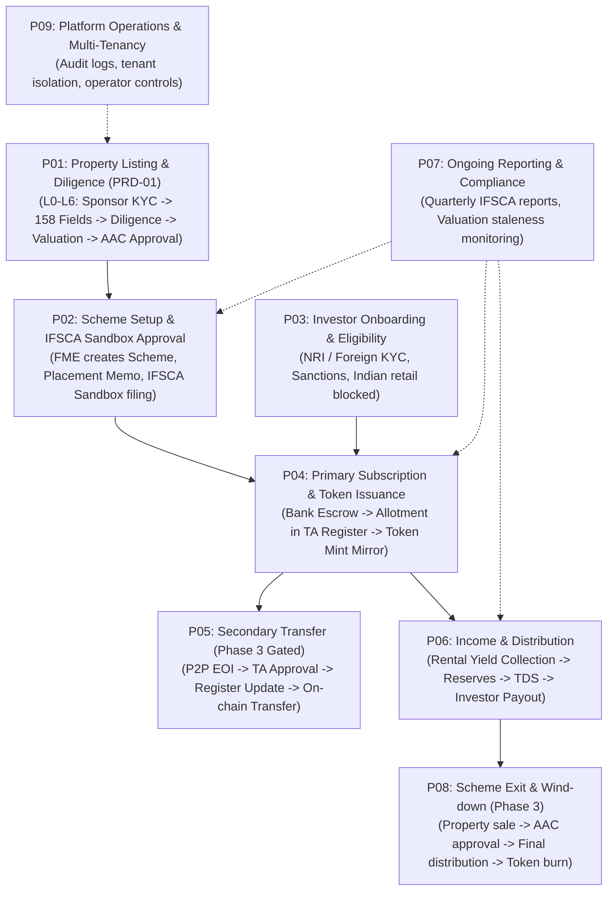
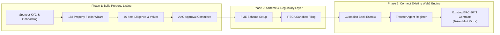

# Assetro Codebase vs. RWA Specification Analysis

This document provides a simple, structured, and comprehensive comparison between:
1. **The Current Codebase (`Assetro`)**: What is currently built in this repository.
2. **PDF 1 — `Assetro-RWA-Feature-List-v2-No-SPV.pdf`**: The macro platform blueprint (354 features, 14 roles, 9 end-to-end flows).
3. **PDF 2 — `Assetro-RWA-PRD-01-Property-Listing-No-SPV.pdf`**: The micro engineering specification for Flow P01 (Property Listing, 10 steps, 158 fields, diligence & committee approval).

---

## 1. Executive Summary & The Core Inversion

```
CURRENT CODEBASE (Assetro)                TARGET SPECIFICATION (PDFs)
┌─────────────────────────────────┐      ┌─────────────────────────────────┐
│     Tail End (Built First)      │      │    Front & Middle (Required)    │
│  • ERC-3643 Smart Contracts     │      │  • P01: Property Listing & DD   │
│  • Sepolia Testnet Deployment   │  vs  │  • P02: IFSCA Scheme Setup      │
│  • Stripe Fiat Checkout         │      │  • P03: NRI / Foreign KYC       │
│  • Basic Investor/Issuer Portal │      │  • P04: Custodian + TA Register │
│  • Instant Token Minting        │      │  • Mirroring on Blockchain      │
└─────────────────────────────────┘      └─────────────────────────────────┘
```

### The Big Picture
* **In the current repository (`Assetro`)**: The platform was built from a **"blockchain-first"** perspective. It implements an ERC-3643 (T-REX) tokenization engine on Ethereum Sepolia, basic manual KYC, Stripe fiat checkout, and generic issuer/investor dashboards. It assumes that an asset is already verified and allows an issuer to immediately create and deploy a token.
* **In the actual intended flow (the two PDFs)**: The platform is a **regulated Real-World Asset (RWA) platform** operating under the **IFSCA (GIFT City) Regulatory Sandbox**. Blockchain tokenization is strictly step 4 (Flow P04), and **tokens are never minted until a physical property has passed 10 rigorous steps of onboarding, physical diligence, legal title search, independent valuation, and committee approval**.
* **What "No-SPV" Means**: In conventional RWA platforms, a separate company (Special Purpose Vehicle / SPV) is incorporated for every single building. In the Assetro "No-SPV" framework, the property is held under an **IFSCA Fund Management Entity (FME) Scheme**. Beneficial units are registered by a licensed Transfer Agent (TA), and tokens act as a digital mirror of that off-chain legal register, removing the legal overhead of creating dozens of separate SPV companies.

---

## 2. Difference Between the Two PDFs

Before comparing with the code, it is important to understand how the two PDF documents relate to each other:

| Dimension | PDF 1: `Feature-List-v2-No-SPV.pdf` | PDF 2: `PRD-01-Property-Listing-No-SPV.pdf` |
| :--- | :--- | :--- |
| **Document Role** | **Macro Blueprint & Ticket Inventory** | **Micro Engineering Specification** |
| **Version & Date** | Version 2.0 (10 September 2026) | Version 1.0 (7 August 2026) |
| **Scope** | Entire platform lifecycle (354 features) | **Flow P01 ONLY** (Property Listing) |
| **Coverage** | **All 9 Business Flows** (P01 through P09) | **10 Steps of Listing** (L0 through L6) |
| **User Roles** | **All 14 Roles** (Investor, Sponsor, AAC, Analyst, FME, Compliance, TA, Ops, Finance, etc.) | **6 Roles involved in listing** (Sponsor, Ops Intake, Analyst, Valuer, FME, AAC) |
| **Blockchain Scope** | Covers token minting, claim registry, transfers, and token mirrors in P04/P05 | **Explicitly ZERO blockchain**: *"Stops before any money, any investor, and any token. NO INVESTOR · NO MONEY · NO CHAIN."* |
| **Granularity** | Lists what feature must exist, its role prefix (e.g. `TRA-15`), module, and release phase (0 to 3) | Lists exact UI field definitions (158 property fields, 65 sponsor fields), database tables, validation rules (`LR-01` to `LR-20`), reason codes (`LST-001` to `LST-020`), and acceptance criteria |

### Summary of Differences Between the Two PDFs:
1. **Breadth vs. Depth**: PDF 1 is a bird's-eye view of all 9 business processes across the company. PDF 2 takes the very first process (**P01 Property Listing**) and specifies every single screen, validation regex, error message, and database foreign key needed to build it.
2. **Boundary Enforcement**: PDF 2 explicitly warns developers: *If you are writing code that touches a wallet, token, or payment, you have violated the scope of PRD-01.* PDF 1, however, tracks the subsequent flows where blockchain contracts (M06) and payments do come into play.

---

## 3. End-to-End Business Flows in the Specifications

The target system defined in the PDFs consists of **9 sequential and parallel flows**:



---

## 4. Deep-Dive Gap Analysis: Current Codebase vs. PDFs

Below is a detailed breakdown of where the current codebase (`Assetro`) stands against the requirements of the two PDF specifications:

### 1. Property Intake & Listing Engine (Flow P01 / PRD-01)
* **In Current Codebase (`Assetro`)**:
  * In [`Token`](file:///home/vhits/Desktop/Projects/Assetro/apps/api/src/modules/tokens/entities/token.entity.ts), real estate is merely an enum value (`AssetType.REAL_ESTATE`).
  * Creating a token only asks for: token name, symbol, decimals, total supply, and a generic description.
  * No real estate data is collected.
* **In PDFs (`PRD-01`)**:
  * Requires a **12-section wizard with 158 structured fields** across 12 distinct groups:
    * Group A: Basic Information (Asset name, typology, RERA registration, possession date)
    * Group B: Location & Cadastral (Survey / Gat / Khasra number, municipal ward, coordinates)
    * Group C: Physical & Measurement (Land area, built-up area, carpet area, lettable units, parking bays, age, structural rating)
    * Group D: Title & Ownership (Registered owner, mode of acquisition, **chain of title deeds**, advocate title opinion)
    * Group E: Statutory Approvals (Sanctioned plan, building permit, environmental clearance, fire NOC, OC/CC)
    * Group F: Encumbrance & Litigation (Mortgages, bank charges, revenue litigation)
    * Group G: Tenancy & Lease Schedule (Tenant names, area leased, lock-in, escalation rate, security deposit)
    * Group H: Financial & Operating History (Gross annual rent, CAM collections, property tax status)
    * Group I: Insurance (Policy number, sum insured, perils covered)
    * Group J: Property Management (Facility manager, annual maintenance contract)
    * Group K: Sponsor Commercial Proposal (Valuation sought, target raise, sponsor co-investment commitment)
    * Group L: Declarations (9 statutory declarations including Benami declaration and source of acquisition funds).
  * Requires two tiers of field completeness: **Tier S** (mandatory to submit) and **Tier A** (required before committee review).

---

### 2. Sponsor (Builder) Entity vs. Generic User
* **In Current Codebase (`Assetro`)**:
  * Has a single generic [`User`](file:///home/vhits/Desktop/Projects/Assetro/apps/api/src/modules/auth/entities/user.entity.ts) table with a role `issuer`.
  * No company-level verification exists for issuers.
* **In PDFs (`PRD-01`)**:
  * Mandates a dedicated `Sponsor` entity with **65 structured fields** (SPN-001 to SPN-065):
    * Company verification (MCA CIN, GSTIN, PAN, registered office address, incorporation date).
    * Directors, Authorized Signatories, and Beneficial Owners (>10% holding).
    * Automated Sanctions, PEP (Politically Exposed Persons), and adverse media screening.
    * 12 mandatory company document slots (Certificate of Incorporation, MoA, AoA, Board Resolution, Audited Financials).
  * Strict rule: An unverified sponsor cannot click "Add a property".

---

### 3. Due Diligence & Valuation Engine
* **In Current Codebase (`Assetro`)**:
  * Completely missing. There are no tables or APIs for due diligence, site visits, or valuation reports.
* **In PDFs (`PRD-01`)**:
  * **46-Point Diligence Checklist** executed by an Analyst: Each item must be marked `PASS`, `FAIL`, `QUERY`, or `WAIVED`.
  * **Threaded Queries**: Formal back-and-forth query mechanism between Analyst and Sponsor with SLA tracking.
  * **External Advisor Management**: Empanelling and tracking independent external experts (Title Advocate, Registered Valuer, Structural Engineer, Chartered Accountant) with conflict-of-interest declarations.
  * **Independent Valuation Engine**: Captures IBBI registered valuer details, valuation method (DCF / Cap Rate), cap rate assumption, guideline value, and an automated **staleness clock** (valuations expire after a configurable validity window).
  * **Geotagged Site Visits**: Captures date, attendees, GPS coordinates, inspection notes, and photo evidence.

---

### 4. Governance & Approval Committee (AAC)
* **In Current Codebase (`Assetro`)**:
  * An issuer can unilaterally deploy a token to the blockchain as soon as they submit the form.
* **In PDFs (`PRD-01`)**:
  * Enforces the **Asset Approval Committee (AAC)**:
    * A dedicated committee of independent reviewers.
    * **Quorum enforcement** (minimum voting members required).
    * **Recusal rules**: Any committee member with a conflict of interest in the sponsor or asset is automatically blocked from voting.
    * **Immutable Approval Pack**: Snapshot generated with an input hash (LR-18). If any property or valuation field changes after pack generation, the pack is invalidated.
    * **Separation of Duties (Maker-Checker)**:
      * Sponsor submits, but cannot approve.
      * Analyst investigates, but cannot approve.
      * AAC approves or declines.
      * Compliance advises, but cannot vote on asset selection.

---

### 5. Regulatory Structure: IFSCA / GIFT City Sandbox vs. Generic Web3
* **In Current Codebase (`Assetro`)**:
  * Built around generic US/EU compliance concepts: accredited investor checks, manual KYC document approval, Stripe checkout in USD/EUR, and on-chain ERC-3643 claim verification.
* **In PDFs (`PRD-01` & `Feature List`)**:
  * Designed specifically for the **IFSCA (International Financial Services Centres Authority) at GIFT City**:
    * **Fund Management Entity (FME)** framework: Schemes are launched under FME regulations.
    * **Investor Eligibility**: Targets Non-Resident Indians (NRIs) and foreign accredited investors; domestic Indian resident retail investors are strictly restricted under IFSCA sandbox caps.
    * **Placement Memorandum (PM)** generation and IFSCA sandbox application filing (Flow P02).
    * **Quarterly Regulatory Reporting**: Automated generation of reports required by IFSCA (Flow P07).

---

### 6. Role of Blockchain: Ledger vs. Digital Mirror
* **In Current Codebase (`Assetro`)**:
  * Smart contracts on Sepolia are the primary source of truth. Investor balances and token supplies originate on-chain.
* **In PDFs (`PRD-01` & `Feature List`)**:
  * The **legal register of record is maintained off-chain by a licensed Transfer Agent (TA)**.
  * Payments are deposited into an approved Custodian bank account.
  * Once the TA enters the investor into the official unit register, an instruction is sent to the blockchain module (M06) to mint a matching digital token.
  * **The token is a mirror of the legal register; it never precedes it.**

---

### 7. Post-Issuance Asset Lifecycle
* **In Current Codebase (`Assetro`)**:
  * Has basic `corporate_actions` and `corporate_action_votes` for generic shareholder votes.
* **In PDFs (`Feature List`)**:
  * **Rental Income & Distribution (Flow P06)**:
    * Tracking gross rental collections from property tenants.
    * Deducting property management expenses, capital expenditure reserves, and tenant maintenance fees.
    * Calculating tax deductions at source (TDS) and net distribution per unit.
    * Payout instructions sent to Custodian and distribution statements generated for investors.
  * **Scheme Exit & Wind-down (Flow P08)**:
    * Real estate asset sale process, proceeds reconciliation, final liquidation distribution, and token burn.

---

## 5. Architectural Comparison Matrix

| System Component | Current Codebase (`Assetro`) | Target Specification (PDFs) | Gap Severity |
| :--- | :--- | :--- | :--- |
| **Asset Intake & Submission** | Basic 5-field token form | 12-section wizard, 158 fields (PRP-001 to PRP-158), title deed chain, encumbrances | 🔴 **Major Gap** |
| **Sponsor Verification** | Generic user login (`role: issuer`) | Dedicated `Sponsor` entity (65 fields), MCA/PAN/CIN, Sanctions/PEP screening | 🔴 **Major Gap** |
| **Due Diligence Checklist** | None | 46 checklist items, analyst findings, threaded queries with SLAs | 🔴 **Major Gap** |
| **Valuation Engine** | None | IBBI registered valuer, cap rate, guideline value, valuation staleness clock | 🔴 **Major Gap** |
| **Approval Committee (AAC)** | None (Issuer self-deploys) | AAC committee, quorate voting, recusal rules, immutable pack hash | 🔴 **Major Gap** |
| **External Advisors** | None | Empanelled lawyers, valuers, engineers, chartered accountants | 🟡 **Missing** |
| **IFSCA / FME Scheme Setup** | None | Flow P02: FME Scheme design, Placement Memorandum, IFSCA sandbox filing | 🔴 **Major Gap** |
| **Smart Contracts (ERC-3643)** | ✅ Full T-REX suite deployed on Sepolia, 9 modular compliance contracts | Token minting used downstream in Flow P04 as mirror of TA register | 🟢 **Reusable Asset** |
| **Identity & KYC (Investors)** | ✅ ONCHAINID (ERC-734/735), Claim issuers, Manual KYC review | Investor KYC (Flow P03) needs NRI/Foreign qualification & sanctions integration | 🟡 **Partially Reusable** |
| **Payments** | Stripe credit card / wire transfers | Regulated Custodian bank escrow accounts | 🟡 **Needs Refactor** |
| **Rental Distribution** | None | Flow P06: Rental accrual, reserves, TDS withholding, distribution statements | 🔴 **Major Gap** |
| **Regulatory Reporting** | None | Flow P07: Quarterly IFSCA compliance filings | 🔴 **Major Gap** |
| **User Roles** | 5 roles (`investor`, `issuer`, `admin`, `compliance_officer`, `transfer_agent`) | 14 roles (`INV`, `OWN`, `AAC`, `ANL`, `FME`, `CMP`, `TRA`, `OPS`, `FIN`, `TEN`, `PLT`, `AUD`, `REG`, `SYS`) | 🔴 **Major Gap** |

---

## 6. How to Bridge the Gap: Recommended Implementation Roadmap

The existing work in `Assetro` is not wasted: the smart contracts, identity registry, multi-tenancy, and NestJS/Next.js foundation form an excellent backend and Web3 infrastructure. However, the business logic must be aligned with the actual RWA regulatory lifecycle:



### Action Steps:
1. **Implement PRD-01 (Flow P01) in Backend (`apps/api`)**:
   * Create the 13 required entities: `Sponsor`, `TitleChainLink`, `Tenancy`, `Valuation`, `ExternalAdvisor`, `AdvisorEngagement`, `ChecklistTemplate`, `ChecklistResult`, `DiligenceQuery`, `SiteVisit`, `ApprovalPack`, `CommitteeDecision`, and `ApprovalCondition`.
   * Implement listing validation rules `LR-01` to `LR-20` and error reason codes `LST-001` to `LST-020`.
2. **Expand Frontend Portals (`apps/web-platform` & `apps/web-admin`)**:
   * Add the Sponsor Onboarding (65 fields) and Property Intake Wizard (158 fields across 12 tabs).
   * Build the Analyst Diligence workbench (checklist, query thread, advisor instructions).
   * Build the AAC Committee Voting dashboard (pack viewer, quorate voting, recusal triggers).
3. **Reposition the Existing Blockchain Service**:
   * Shift token contract deployment from the initial property creation step to **Flow P04 (Primary Subscription)**, triggered only after AAC asset approval and Transfer Agent allotment.
